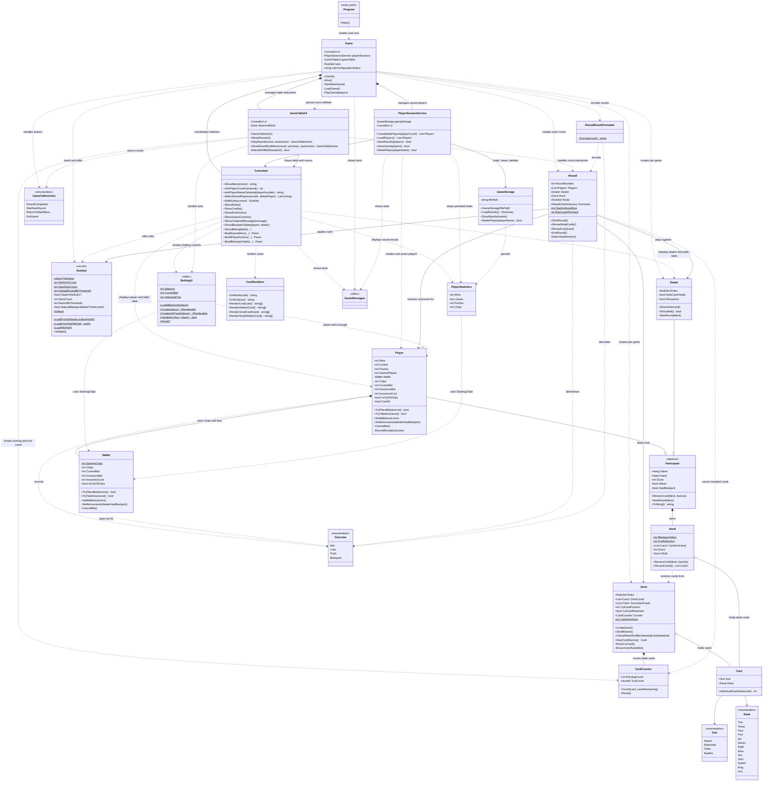

# Blackjack Class Diagram and Responsibilities

This document describes the current runtime structure of the console Blackjack game. It
focuses on the responsibilities of the main classes and how they collaborate.

## Class diagram

## Responsibility boundaries

| Class | Responsibility | Should not own |
|---|---|---|
| `Program` | Entry point; creates and runs `Game`. | Game rules, persistence, or console flow. |
| `Game` | Loads rules, routes main-menu choices, creates players and game objects, coordinates rounds, saves results, and decides when a session ends. | Low-level terminal rendering or JSON serialization. |
| `ConsoleUi` | Displays menus, prompts, rules, messages, and table content; reads user input. | Game flow, round resolution, or file access. |
| `GameTableUI` | Handles table interactions such as betting, insurance, player turns, and round-end choices; shows the deck's card count and reports the next action to `Game`. | Persisting results or deciding round outcomes. |
| `PlayerSessionService` | Creates and loads players, maps saved statistics, and coordinates save/delete operations and related messages. | JSON file details or rendering menus. |
| `GameStorage` | Reads and writes player statistics in JSON, maintains the readable text report, and deletes saved players. | Player creation or game logic. |
| `PlayerStatistics` | Represents persisted wins, losses, pushes, and chips. | Game behavior or file operations. |
| `RuleSet` | Loads and validates house rules from `blackjack-rules.json` and provides defaults. | Running a game or displaying the settings menu. |
| `Round` | Deals starting cards, reveals cards to the card counter, plays the dealer turn, determines outcomes, and settles bets and insurance. | Terminal interaction or persistence. |
| `RoundResultFormatter` | Formats a completed round's outcomes for display. | Determining outcomes or saving them. |
| `Participant` | Shares a name and hand, card receiving, scoring state, and round reset behavior. | Player statistics or dealer strategy. |
| `Player` | Tracks a player's results and forwards chips, bets, and insurance to its private `Wallet`. | Console interaction or saved-file management. |
| `Wallet` | Tracks chips, bets, and insurance and settles them based on an outcome. | Statistics, console interaction, or deciding the outcome. |
| `Dealer` | Represents the dealer, reveals the hole card, and decides whether to hit based on the rules. | Choosing player actions or rendering cards. |
| `Deck` | Creates, shuffles, and deals cards, manages discards and the cut card, reshuffles the discard pile if the shoe runs empty (it never creates new cards mid-game), and owns the card counter. | Hand scoring or deciding winners. |
| `CardCounter` | Tracks running and true counts of cards that have become visible. | Changing game outcomes or displaying the count. |
| `Hand` | Holds cards, calculates hand score and softness, and owns `BlackjackValue` and `AceReduction`. | Deciding who wins. |
| `Card` | Stores suit and rank and provides a card's base value. | Scoring a complete hand. |
| `BettingUI` | Renders betting controls and applies betting key input through `Player`. | Owning player balances or resolving payouts. |
| `CardRenderer` | Produces the text representation of visible and hidden cards. | Game logic or card ownership. |
| `GameMessages` | Holds the texts and formats shown to the player. | Game logic or deciding when a message is shown. |

## Runtime flow

1. `Program` creates `Game` and calls `Run()`.
2. `Game` loads a `RuleSet` from `blackjack-rules.json` and creates `ConsoleUi`,
   `PlayerSessionService`, and `GameTableUI`.
3. The player chooses a new or saved game in `ConsoleUi`. `PlayerSessionService` loads saved
   statistics through `GameStorage` and creates the selected `Player` objects.
4. For a game, `Game` creates a `Deck` and `Dealer` with the same rules. For each round it
   creates a `Round` and starts the round, which resets hands, reshuffles if the cut card was
      reached or the shoe cannot cover the worst case for all participants, and deals the
      initial cards face down. The cut card never triggers a reshuffle mid-round.
5. `GameTableUI` handles betting, then flips the cards and calls `Round.RevealInitialCards()`
   so the card counter only counts visible cards. It then handles optional insurance and
   player choices, using `ConsoleUi` and `BettingUI` to display the table and process input.
6. When the table reports that the round is complete, `Game` calls `Round.EndRound()` to play
   the dealer and settle outcomes. `RoundResultFormatter` prepares the summary, and
   `PlayerSessionService` saves updated statistics through `GameStorage`.
7. `GameTableUI` shows the round-end menu. `Game` starts another round, returns to the main
   menu, or exits according to the returned `GameTableAction`.

## Related documentation

See [HouseRules.md](HouseRules.md) for details about the house rules and
[README.md](README.md) for project setup and usage.
